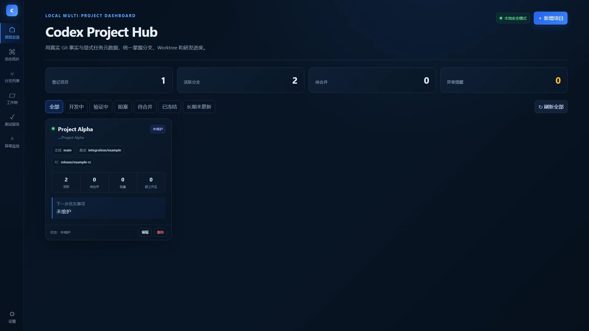
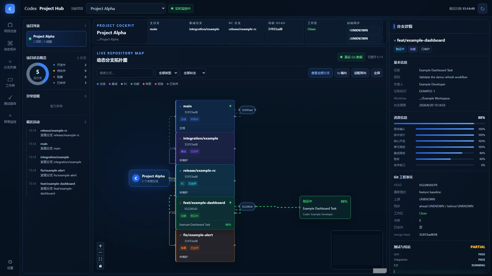
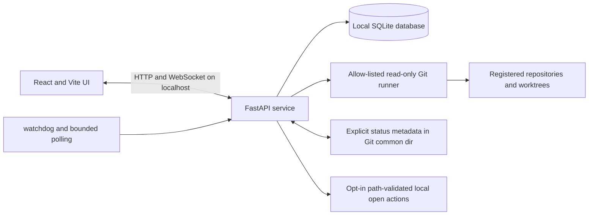

# Codex Project Hub

English | [简体中文](README.zh-CN.md)


A Windows-local dashboard for observing multiple Git repositories and worktrees from one place. It reads Git facts through an allow-listed, read-only command runner and combines them with explicitly maintained task metadata to present project health, branch topology, worktree changes, alerts, and recent activity.

> **Release status:** Codex Project Hub is licensed under the Apache License 2.0. The v0.1.0 release is built from an audited clean-root history.



## Why this project exists

Working across several local repositories and linked worktrees makes it easy to lose track of which branch is checked out, which worktree is dirty, whether a branch is ahead or behind its upstream, and which task status was actually recorded. Codex Project Hub gathers those facts in a single local interface without inferring task progress from commit counts.

The application is designed for a single developer on a Windows workstation. It binds to `127.0.0.1` by default and stores its own state locally.

## What it does

- Registers, edits, removes, and switches between multiple local Git repositories.
- Resolves a repository's Git common directory, primary worktree, and linked worktrees.
- Reads local branches, HEADs, upstream relationships, ahead/behind counts, merge bases, merged state, commit summaries, and worktree changes.
- Presents a project overview and a compressed React Flow branch topology with search, filters, zoom, fit, fullscreen, and layout controls.
- Shows explicit task metadata, phase progress, test evidence, blockers, and next actions from `codex-dashboard/status.json` when that metadata exists.
- Reports missing metadata as “not maintained” and unknown Git facts as `UNKNOWN` instead of inventing progress.
- Watches registered repositories for meaningful changes and refreshes the browser through a local WebSocket connection.
- When explicitly enabled, provides path-validated shortcuts for opening a registered folder, terminal, or Visual Studio Code.
- Stores project registrations, snapshots, and activity in a local SQLite database.



Both screenshots come from the running application with isolated synthetic repositories. See the [capture provenance and regeneration procedure](docs/images/README.md).

## What it does not do

- It does not run or orchestrate Codex or other coding agents.
- It does not read a private Codex conversation database.
- It does not provide cloud sync, team accounts, or multi-user authorization.
- It does not manage GitHub or GitLab pull requests, issues, or CI jobs.
- It does not automatically fetch, merge, rebase, reset, clean, delete branches, or modify monitored business code.
- It does not derive task completion from commits, file counts, or activity volume.

## Architecture



The backend uses argument arrays rather than shell command strings for Git inspection. A failure in one repository is isolated from the others. Status metadata is separate from Git facts and is only written through an explicit API or helper-script action.

## System requirements

- Windows 10 or Windows 11
- CPython 3.11.x (64-bit), available as `py -3.11` through the Windows `py` launcher
- Node.js `20.19.x` or `22.12.0` and later, with npm (`^20.19.0 || >=22.12.0`)
- Git available on `PATH`
- Visual Studio Code is optional and only required for the “Open in VS Code” shortcut

## Quick start

```bat
git clone https://github.com/wyg916/codex-project-hub.git
cd codex-project-hub
install.bat
start.bat
```

The project registry is empty on first start. Register repositories through **Add project** in the UI. For an isolated demonstration, you can first run `.venv\Scripts\python.exe scripts\create-demo-repo.py` and then register one of the generated repositories. `config/default-projects.json` intentionally contains an empty project list.

`install.bat` creates `.venv`, installs the hash-locked Python application and test dependencies from `backend/pylock.toml`, runs `npm ci`, installs Playwright Chromium, builds the frontend, and initializes SQLite. The lock targets CPython 3.11 on Windows x86-64. `start.bat` starts the production build at <http://127.0.0.1:8765>. The root `一键启动.bat` is an equivalent double-click entry point.

```bat
stop.bat
```

The stop command only targets a process recorded in this project's PID file.

## Configuration

The launcher and backend read variables from the current process environment. They do **not** automatically load `.env`; [`.env.example`](.env.example) is a safe reference.

| Variable | Default | Purpose |
|---|---|---|
| `CPC_DATA_DIR` | `<project>/data` | Directory for SQLite, logs, and PID files |
| `CPC_SCAN_INTERVAL` | `4` | Foreground polling interval in seconds; values below 1 are raised to 1 |
| `CPC_DISABLE_BACKGROUND` | unset | Set to `1` to disable watchdog and background polling |
| `CPC_ENABLE_SYSTEM_ACTIONS` | unset (disabled) | Set to exactly `1` to enable the native directory picker and local folder, terminal, and VS Code actions |
| `CPC_ALLOWED_ORIGINS` | built-in loopback origins | Optional comma-separated additional explicit HTTP(S) origins; non-root paths, credentials, queries, and fragments are rejected |
| `CPC_NO_BROWSER` | unset | Set to `1` to prevent `start.bat` from opening a browser |

PowerShell example:

```powershell
# Optional: enable native actions only on a trusted local machine.
$env:CPC_ENABLE_SYSTEM_ACTIONS = "1"
$env:CPC_NO_BROWSER = "1"
.\start.bat
```

## Usage

### Register a repository

1. Open the project overview.
2. Choose **Add project**.
3. Select or paste a local Git repository or linked-worktree path.
4. Review the detected common directory and worktrees.
5. Optionally declare the main, integration, and release-candidate branches.

Removing a registration deletes the dashboard's local registration; it does not delete the repository or its branches.

### Maintain explicit task status

The status file lives at `<git-common-dir>/codex-dashboard/status.json` and is shared by all worktrees for the same repository. Use the helper rather than editing the JSON by hand:

```powershell
.venv\Scripts\python.exe scripts\update-codex-status.py `
  --repo "C:\Projects\ExampleProject" `
  --branch "feat/example" `
  --task-name "Example task" `
  --status active `
  --result PARTIAL `
  --development 70 `
  --unit-test 40 `
  --next-action "Add integration coverage"
```

Invalid metadata is preserved and rejected rather than silently overwritten. See the [status schema](docs/STATUS_SCHEMA.md) for the complete contract.

### Create isolated demo repositories

```powershell
.venv\Scripts\python.exe scripts\create-demo-repo.py
```

The script creates synthetic repositories under `data/demo-repositories` with branches, commits, worktrees, worktree changes, and explicit task metadata. It does not require access to a private project.

## Project structure

```text
backend/          FastAPI service, Git scanners, persistence, and tests
config/           Empty first-start project-registration configuration
data/             Ignored local runtime state; only .gitkeep is tracked
docs/             User, schema, test, acceptance, and screenshot documentation
frontend/         React, TypeScript, Vite, Vitest, and Playwright application
scripts/          Windows install, start, stop, test, and metadata helpers
```

## Development, build, and test

Install dependencies once, then start the FastAPI reload server and Vite development server:

```bat
install.bat
dev.bat
```

Run the complete local gate:

```bat
test-all.bat
```

That script runs backend pytest tests, frontend Vitest tests, the TypeScript/Vite production build, Playwright end-to-end tests, and helper-script checks. Individual commands are also available:

```powershell
.venv\Scripts\python.exe -m pytest backend\tests

cd frontend
npm run test
npm run build
npm run e2e
```

Final results for the exact release candidate are recorded in [docs/TEST_REPORT.md](docs/TEST_REPORT.md) and [docs/FINAL_ACCEPTANCE.md](docs/FINAL_ACCEPTANCE.md). They distinguish technical verification from the owner-controlled publication steps.

## Security and privacy

- The service binds to loopback by default; it is not designed to be exposed directly to a network.
- Git inspection uses an allow list and subprocess argument arrays. It does not automatically perform destructive or network-changing Git operations.
- Native directory and local open actions are disabled by default and require `CPC_ENABLE_SYSTEM_ACTIONS=1`; requested paths must exactly match a registered repository root or worktree.
- Cross-origin browser access is limited to built-in loopback origins plus explicit HTTP(S) additions in `CPC_ALLOWED_ORIGINS`.
- Remote URLs are redacted before display or logging.
- Repository paths, branch names, commit metadata, worktree changes, task metadata, and activity are sensitive local data. Review them before sharing logs or screenshots.
- The application stores registrations and snapshots in `data/control-center.db`; explicit task metadata is stored under the repository's Git common directory.
- No built-in telemetry or cloud synchronization is configured. Installation still contacts PyPI/Python package hosts, the configured npm registry, and Playwright's configured Chromium download host.

Read [SECURITY.md](SECURITY.md) before reporting a vulnerability and [PRIVACY.md](PRIVACY.md) for the complete local-data inventory and deletion guidance.

## Roadmap

Near-term work is intentionally limited to the local dashboard:

- Keep the Apache-2.0 license and third-party notice inventory aligned with release artifacts.
- Keep the Windows installation and clean-start path reproducible.
- Expand tests around path boundaries, malformed repositories, and large-worktree behavior.
- Improve accessibility and documentation for compressed branch topology.
- Add opt-in import/export for sanitized local configuration.

Cloud sync, multi-user permissions, agent execution, pull-request management, CI orchestration, and automatic Git mutation are not committed roadmap features.

## Contributing and support

The project is available under Apache-2.0. Read [CONTRIBUTING.md](CONTRIBUTING.md), [CODE_OF_CONDUCT.md](CODE_OF_CONDUCT.md), and [SUPPORT.md](SUPPORT.md) before opening a contribution or support request.

Security reports must follow [SECURITY.md](SECURITY.md) and must not be posted with exploit details in a public issue.

## License

Copyright 2026 wyg. Licensed under the [Apache License 2.0](LICENSE).

Third-party components retain their own terms; see [THIRD_PARTY_NOTICES.md](THIRD_PARTY_NOTICES.md) and [NOTICE](NOTICE).

## Acknowledgements

Codex Project Hub is built with FastAPI, React, React Flow, Vite, watchdog, SQLite, Vitest, and Playwright. Thanks to their maintainers and to all transitive dependency authors. No upstream project name, logo, screenshot, or README text is adopted as this project's branding.

## Independent project notice

> Codex Project Hub is an independent open-source project and is not affiliated with, endorsed by, or sponsored by OpenAI.
>
> Codex Project Hub 是一个独立的开源项目，与 OpenAI 不存在隶属、背书或赞助关系。
