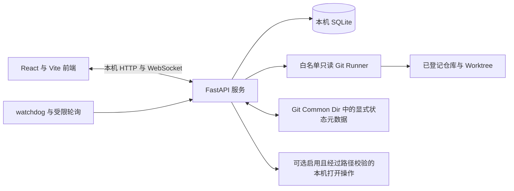

# Codex Project Hub

[English](README.md) | 简体中文


一个运行在 Windows 本机的多 Git 项目与 Worktree 状态总控台。它只通过白名单中的只读 Git 命令获取事实，再叠加人工明确维护的任务元数据，用统一界面展示项目健康度、分支拓扑、工作区变化、异常提醒和最近活动。

> **发布状态：** 项目尚未选定开源许可证。在批准并加入 `LICENSE` 前，公开再分发和首次公开发布均处于阻断状态。


## 为什么需要它

同时维护多个本地仓库和 linked Worktree 时，很容易忘记当前检出了哪个分支、哪个工作区尚未清理、分支相对上游是领先还是落后，以及任务状态是否真的有人维护。Codex Project Hub 把这些事实集中到一个本地界面，并且不会用提交数量推断任务进度。

当前应用面向 Windows 单机开发者。服务默认只绑定 `127.0.0.1`，应用自身数据保存在本机。

## 已实现能力

- 登记、编辑、移除和切换多个本地 Git 仓库。
- 识别 Git Common Dir、主 Worktree 和 linked Worktree。
- 读取本地分支、HEAD、上游、ahead/behind、merge-base、已合并状态、提交摘要和工作区变化。
- 提供项目总览与压缩分支拓扑，支持搜索、筛选、缩放、适配、全屏和布局切换。
- 在存在 `codex-dashboard/status.json` 时展示显式任务元数据、阶段进度、测试证据、阻塞项和下一步。
- 元数据缺失时显示“未维护”，Git 事实未知时显示 `UNKNOWN`，不制造进度。
- 监听已登记仓库的有效变化，并通过本地 WebSocket 刷新页面。
- 明确启用后，提供受路径边界校验的“打开目录、终端、Visual Studio Code”快捷操作。
- 使用本机 SQLite 保存项目登记、快照和活动记录。


两张截图均来自使用隔离合成仓库运行的真实应用。来源与重新生成流程见[截图出处说明](docs/images/README.md)。

## 明确不做什么

- 不运行或编排 Codex 或其他 Coding Agent。
- 不读取 Codex 私有会话数据库。
- 不提供云同步、团队账户或多用户权限。
- 不管理 GitHub/GitLab Pull Request、Issue 或 CI 任务。
- 不自动 fetch、merge、rebase、reset、clean、删除分支或修改被监控项目业务代码。
- 不从提交数、文件数或活动量推断任务完成度。

## 技术架构



后端使用参数数组而不是 Shell 字符串执行 Git 检查，单个仓库失败不会拖垮其他仓库。任务状态元数据与 Git 事实分离，只有明确调用 API 或辅助脚本时才会写入。

## 系统要求

- Windows 10 或 Windows 11
- 64 位 CPython 3.11.x，并可通过 Windows `py` 启动器以 `py -3.11` 调用
- Node.js `20.19.x` 或 `22.12.0` 及更高版本，并带有 npm（`^20.19.0 || >=22.12.0`）
- `PATH` 中可用的 Git
- Visual Studio Code 为可选项，仅“在 VS Code 中打开”功能需要

## 快速开始

```bat
git clone https://github.com/wyg916/codex-project-hub.git
cd codex-project-hub
install.bat
start.bat
```

首次启动时项目登记为空，请在界面中通过“新增项目”登记仓库。如需隔离演示，可先运行 `.venv\Scripts\python.exe scripts\create-demo-repo.py`，再登记生成的演示仓库之一。`config/default-projects.json` 有意保持空项目列表。

`install.bat` 会创建 `.venv`、根据 `backend/pylock.toml` 安装带哈希锁定的 Python 应用与测试依赖、执行 `npm ci`、安装 Playwright Chromium、构建前端并初始化 SQLite。该锁文件面向 Windows x86-64 上的 CPython 3.11。`start.bat` 在 <http://127.0.0.1:8765> 启动生产构建。根目录的 `一键启动.bat` 是等价的双击入口。

```bat
stop.bat
```

停止命令只处理本项目 PID 文件记录的进程。

## 配置

启动器和后端读取当前进程环境变量，**不会**自动加载 `.env`；[`.env.example`](.env.example) 仅作为安全参考。

| 变量 | 默认值 | 用途 |
|---|---|---|
| `CPC_DATA_DIR` | `<项目目录>/data` | SQLite、日志和 PID 文件目录 |
| `CPC_SCAN_INTERVAL` | `4` | 当前项目轮询秒数；小于 1 的值会提升为 1 |
| `CPC_DISABLE_BACKGROUND` | 未设置 | 设为 `1` 时禁用 watchdog 和后台轮询 |
| `CPC_ENABLE_SYSTEM_ACTIONS` | 未设置（禁用） | 仅设为 `1` 时启用原生目录选择及打开目录、终端和 VS Code 操作 |
| `CPC_ALLOWED_ORIGINS` | 内置回环 Origin | 可选的逗号分隔额外 HTTP(S) Origin；拒绝非根路径、凭据、查询参数和片段 |
| `CPC_NO_BROWSER` | 未设置 | 设为 `1` 时阻止 `start.bat` 自动打开浏览器 |

PowerShell 示例：

```powershell
# 可选：仅在可信本机环境中启用原生操作。
$env:CPC_ENABLE_SYSTEM_ACTIONS = "1"
$env:CPC_NO_BROWSER = "1"
.\start.bat
```

## 使用方法

### 登记仓库

1. 打开项目总览。
2. 点击“新增项目”。
3. 选择或粘贴一个本地 Git 仓库或 linked Worktree 路径。
4. 检查识别出的 Common Dir 和 Worktree。
5. 按需显式指定主分支、集成分支和 RC 分支。

移除登记只删除总控台中的本地登记，不会删除仓库或分支。

### 维护显式任务状态

状态文件位于 `<git-common-dir>/codex-dashboard/status.json`，同一仓库的全部 Worktree 共享。推荐使用辅助脚本，不要手工编辑 JSON：

```powershell
.venv\Scripts\python.exe scripts\update-codex-status.py `
  --repo "C:\Projects\ExampleProject" `
  --branch "feat/example" `
  --task-name "示例任务" `
  --status active `
  --result PARTIAL `
  --development 70 `
  --unit-test 40 `
  --next-action "补充集成测试"
```

无效元数据会被保留并拒绝覆盖。完整约束见[状态 Schema](docs/STATUS_SCHEMA.md)。

### 创建隔离的演示仓库

```powershell
.venv\Scripts\python.exe scripts\create-demo-repo.py
```

脚本会在 `data/demo-repositories` 下创建带分支、提交、Worktree、工作区变化和显式任务元数据的合成仓库，不需要访问任何私有项目。

## 项目目录

```text
backend/          FastAPI 服务、Git 扫描、持久化与测试
config/           首次启动为空的项目登记配置
data/             被忽略的本机运行数据；仅跟踪 .gitkeep
docs/             用户、Schema、测试、验收与截图文档
frontend/         React、TypeScript、Vite、Vitest 与 Playwright 应用
scripts/          Windows 安装、启动、停止、测试与状态维护脚本
```

## 开发、构建与测试

安装依赖后，启动 FastAPI reload 服务和 Vite 开发服务器：

```bat
install.bat
dev.bat
```

运行完整本地门禁：

```bat
test-all.bat
```

该脚本依次运行 pytest、Vitest、TypeScript/Vite 生产构建、Playwright 端到端测试和辅助脚本检查。也可以分别执行：

```powershell
.venv\Scripts\python.exe -m pytest backend\tests

cd frontend
npm run test
npm run build
npm run e2e
```

准确发布候选的最终结果将填写到 [docs/TEST_REPORT.md](docs/TEST_REPORT.md) 和 [docs/FINAL_ACCEPTANCE.md](docs/FINAL_ACCEPTANCE.md)。两份文件当前均为待填写的 2026-08-20 模板；未勾选或“待实测”条目不构成通过结论。

## 安全与隐私

- 服务默认只绑定本机回环地址，不适合直接暴露到网络。
- Git 检查使用命令白名单和 subprocess 参数数组，不会自动执行破坏性或改变远程状态的 Git 操作。
- 原生目录选择和本机打开操作默认禁用，仅 `CPC_ENABLE_SYSTEM_ACTIONS=1` 时启用；请求路径必须与已登记仓库根目录或 Worktree 完全匹配。
- 跨 Origin 浏览器访问仅限内置回环 Origin 及 `CPC_ALLOWED_ORIGINS` 中明确追加的 HTTP(S) Origin。
- 远程 URL 在展示或记录前会脱敏。
- 仓库路径、分支名、提交元数据、工作区变化、任务状态和活动记录都属于敏感本机数据，分享日志或截图前必须检查。
- 项目登记和快照保存在 `data/control-center.db`；显式任务元数据保存在 Git Common Dir 下。
- 当前没有内置遥测或云同步；安装过程仍会访问 PyPI/Python 包托管服务、所配置的 npm Registry，以及 Playwright 配置的 Chromium 下载源。

漏洞报告前请阅读 [SECURITY.md](SECURITY.md)，本机数据清单和删除方式见 [PRIVACY.md](PRIVACY.md)。

## Roadmap

近期工作有意限定在本地总控台范围：

- 完成开源许可证和第三方声明审批。
- 保持 Windows 安装和全新启动路径可复现。
- 补充路径边界、损坏仓库和大型 Worktree 场景测试。
- 改善压缩分支拓扑的无障碍体验和文档。
- 提供可选的脱敏配置导入/导出。

云同步、多用户权限、Agent 执行、Pull Request 管理、CI 编排和自动 Git 修改不是已承诺的 Roadmap 功能。

## 贡献与支持

项目正在准备首次开源发布。提交贡献或支持请求前，请阅读 [CONTRIBUTING.md](CONTRIBUTING.md)、[CODE_OF_CONDUCT.md](CODE_OF_CONDUCT.md) 和 [SUPPORT.md](SUPPORT.md)。在项目许可证选定前，不能接受实质性代码贡献。

安全问题必须按 [SECURITY.md](SECURITY.md) 私下报告，不得在公开 Issue 中发布利用细节。

## License

**等待所有者决定。** 当前尚未授予开源许可证，也没有 `LICENSE` 文件。在版权持有人明确选择并加入许可证前，所有权利保留。这是发布阻断项，不构成任何临时授权。

当前候选为 MIT 和 Apache-2.0。第三方组件继续适用各自条款，详见 [THIRD_PARTY_NOTICES.md](THIRD_PARTY_NOTICES.md)。

## 致谢

Codex Project Hub 使用 FastAPI、React、React Flow、Vite、watchdog、SQLite、Vitest 和 Playwright 构建。感谢这些项目及全部传递依赖的维护者。本项目不把任何参考项目的名称、Logo、截图或 README 文案作为自身品牌表达。

## 独立项目声明

> Codex Project Hub is an independent project preparing for an open-source release and is not affiliated with, endorsed by, or sponsored by OpenAI.
>
> Codex Project Hub 是一个正在准备开源发布的独立项目，与 OpenAI 不存在隶属、背书或赞助关系。
